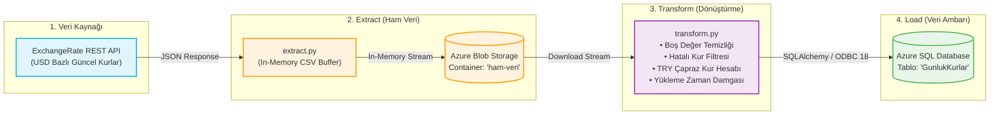

<div align="center">

# 💸 Azure Cloud Tabanlı Finansal ETL Pipeline
### *Gerçek Zamanlı Döviz Kurları Ingestion, Veri Temizleme & Azure SQL Veri Ambarı Pipeline'ı*

<p align="center">
  
  
  
  
  
  
</p>

<p align="center">
  <b>Uçtan Uca Bulut Veri Mühendisliği Çözümü</b><br>
  REST API ➔ In-Memory Veri Çıkarımı ➔ Azure Data Lake (Blob) ➔ Dönüştürme & Zenginleştirme ➔ Azure SQL Database
</p>

---

</div>

## 📌 Proje Genel Bakışı

Bu proje, global döviz kuru verilerini harici bir **REST API** kaynağından çekip, **bulut depolama (Data Lake)** üzerinde ham veri (raw data) olarak saklayan, ardından **Pandas** ile temizleyip zenginleştirerek **Azure SQL Database** ortamına aktaran uçtan uca modern bir **ETL (Extract - Transform - Load)** veri mimarisidir.

Tüm I/O işlemleri yerel diske bağımlı kalmadan doğrudan **bellek üzerinden (In-Memory / `io.StringIO`)** akıtılarak yüksek performans ve hız hedeflenmiştir.

---

## 🏗️ Veri Mimarisi & Akış Şeması



---

## ⚡ ETL Aşamaları Detayı

### 1️⃣ Extract (`extract.py`)
- **API Entegrasyonu:** ExchangeRate-API üzerinden USD bazlı anlık pariteler JSON formatında çekilir.
- **Bellek İçi Hazırlık:** Pandas DataFrame'e dönüştürülen ham veri, diske yazma maliyetini önlemek amacıyla `io.StringIO` kullanılarak RAM üzerinde `.csv` formatına serileştirilir.
- **Data Lake Yüklemesi:** `YYYY-MM-DD_kurlar.csv` formatında isimlendirilerek Azure Blob Storage'daki `ham-veri` kapsayıcısına aktarılır.

### 2️⃣ Transform (`transform.py`)
- **Ham Veri Okuma:** Azure Blob Storage'dan bugünün CSV verisi stream olarak okunur.
- **Temizlik & Filtreleme:**
  - `dropna()` ile eksik satırlar ayıklanır.
  - Negatif veya sıfır olan hatalı kur değerleri elenir (`Kur_USD > 0`).
- **Zenginleştirme (Feature Engineering):**
  - **TRY Çapraz Kuru:** USD/TRY baz alınarak tüm para birimleri için anlık Türk Lirası karşılığı (`TRY_Karsiligi`) hesaplanır.
  - **Audit Timestamp:** Verinin işlenme anı `Yukleme_zamani` kolonu ile etiketlenir.

### 3️⃣ Load (`transform.py`)
- **Güvenli Bağlantı:** `.env` üzerinden okunan kimlik bilgileriyle `ODBC Driver 18 for SQL Server` bağlantı cümlesi oluşturulur.
- **Veritabanına Yazım:** SQLAlchemy ve `pyodbc` motoru yardımıyla optimize edilmiş toplu veri yazımı gerçekleştirilerek Azure SQL `GunlukKurlar` tablosuna aktarılır.

---

## 🗂️ Proje Dizin Yapısı

```text
Finans-ETL/
│
├── .env                  # Veritabanı ve gizli bağlantı anahtarları (Gitignore ile korunur)
├── .env.example          # Güvenli ortam değişkenleri şablonu
├── .gitignore            # Hassas dosyaların ve venv'in dışlanması
├── extract.py            # API'den veri çekme ve Azure Blob'a yükleme adımı
├── transform.py          # Veriyi temizleme, zenginleştirme ve Azure SQL'e basma adımı
└── README.md             # Proje dokümantasyonu
```

---

## 🛡️ Güvenlik & Konfigürasyon

Proje, kurumsal güvenlik standartlarına uygun olarak tasarlanmıştır. Veritabanı ve Azure kimlik bilgileri kaynak kodda **hardcoded** olarak tutulmaz.

1. Proje kök dizininde `.env` dosyasını yapılandırın:
   ```env
   DB_SERVER=sql-finans-kerem2026.database.windows.net
   DB_DATABASE=db-finans
   DB_USERNAME=adminkerem
   DB_PASSWORD=your_secure_password
   ```

2. `.gitignore` dosyası ile `.env`, `__pycache__` ve `.venv` otomatik olarak versiyon kontrolü dışında tutulur.

---

## 🚀 Kurulum ve Çalıştırma

### 1. Depoyu Klonlayın & Sanal Ortamı Başlatın
```bash
git clone https://github.com/kullaniciadi/Finans-ETL.git
cd Finans-ETL

# Sanal ortam oluşturma ve aktif etme (Windows)
python -m venv .venv
.venv\Scripts\activate
```

### 2. Gerekli Paketleri Yükleyin
```bash
pip install pandas requests azure-storage-blob sqlalchemy pyodbc python-dotenv
```

> [!NOTE]
> Azure SQL bağlantısı için sisteminizde **ODBC Driver 18 for SQL Server** kurulu olmalıdır.

### 3. Pipeline'ı Tetikleyin

```bash
# 1. Ham veriyi API'den alıp Azure Blob Storage'a yaz
python extract.py

# 2. Veriyi temizleyip dönüştür ve Azure SQL'e yükle
python transform.py
```

---

## 📊 Örnek Hedef Tablo Şeması (`GunlukKurlar`)

| Kolon Adı | Tip | Açıklama |
| :--- | :--- | :--- |
| `Para_Birimi` | `VARCHAR(10)` | Döviz Kodu (EUR, GBP, JPY...) |
| `Kur_USD` | `FLOAT` | 1 USD karşılığı parite değeri |
| `Tarih` | `DATE` | Verinin çekildiği günün tarihi |
| `TRY_Karsiligi` | `FLOAT` | 1 Birim dövizin hesaplanan TL değeri |
| `Yukleme_zamani` | `DATETIME` | Verinin ETL'den geçip SQL'e yazıldığı an |

---

<div align="center">
  <sub>Geliştirici: <b>Kerem</b> • Modern Cloud Data Engineering Projesi</sub>
</div>

